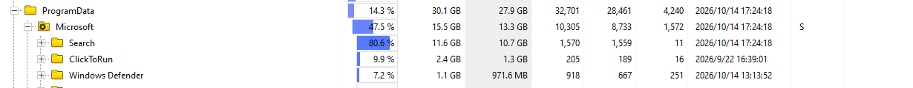
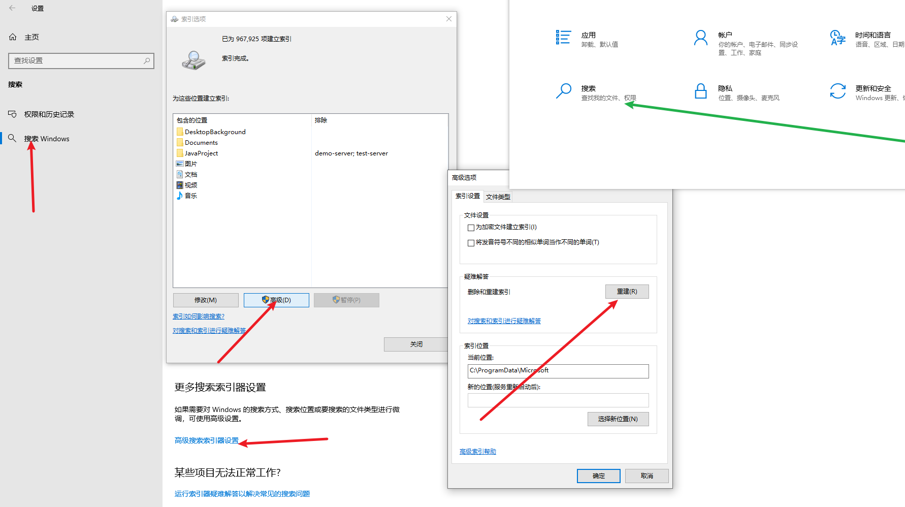

# 占大头的可清理文件
## 1. onedrive
C:\Program Files\Microsoft OneDrive
这些数字文件夹是更新迭代产物

查看可执行文件，确认产品版本和修改日期，按时间倒序，删掉其他的数字文件夹

## 2. NVIDIA
C:\ProgramData\NVIDIA Corporation\Downloader
这个下面有一个残留的安装程序文件夹

C:\Users\Admin\AppData\Local\NVIDIA\DXCache
这是dx缓存，可以删除，再使用中就跳过

## 3. C:\ProgramData\Microsoft

### 3.1 search是索引结果，不要删除，通过重建来瘦身

### 3.2 ClickToRun\ProductReleases
office应用旧版本安装文件缓存，可删除

### 3.3 Window Defender

1. **`Windows Defender\Definition Updates\Backup` (443 MB)**
    
    - **说明**：这是 Windows Defender 病毒库更新前的**旧版本备份**。
        
    - **操作**：**可以安全删除**。Defender 如果更新出问题，会自动重新下载，不需要这个旧备份。
        
2. **`Windows Defender\Definition Updates\{E707...}` (224 MB)**
    
    - **说明**：这通常是病毒库的某个临时更新包或残留。
        
    - **操作**：可以删除。通常 Defender 只保留最新的一个版本，旧版本可以清掉。

## 4. local/Temp临时文件夹
C:\Users\Admin\AppData\Local\Temp
这个文件夹下的东西直接删除

## 5. C:\Windows\System32下
#### 5.1 **`DriverStore\FileRepository`**
windows 驱动备份仓库，