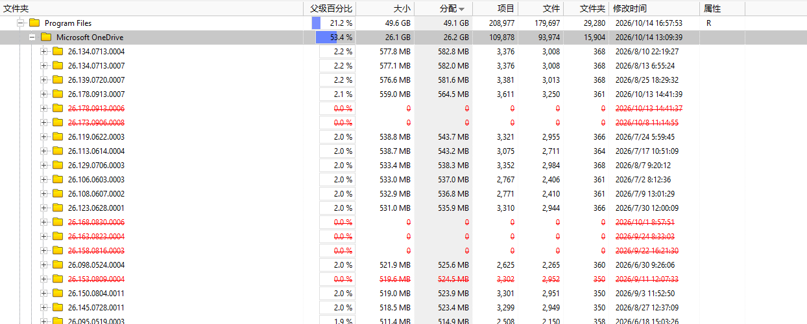
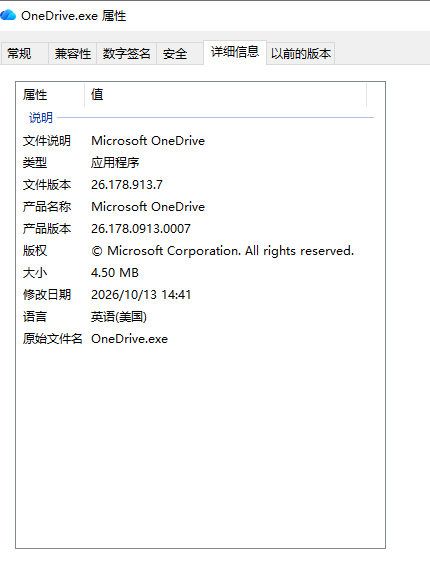

# 占大头的可清理文件
## 1. onedrive
C:\Program Files\Microsoft OneDrive
这些数字文件夹是更新迭代产物

查看可执行文件，确认产品版本和修改日期，按时间倒序，删掉其他的数字文件夹

## 2. NVIDIA
C:\ProgramData\NVIDIA Corporation\Downloader
这个下面有一个残留的安装程序文件夹

C:\Users\Admin\AppData\Local\NVIDIA\DXCache
这是dx缓存，可以删除，再使用中就跳过

